<!-- markdownlint-disable-next-line MD041 -->

  

  

> [!IMPORTANT]
> **The guides, tables and calculators live on the docs site: [nathanielinman.github.io/AdventuresUnlimited](https://nathanielinman.github.io/AdventuresUnlimited/)**. It has search, a sidebar and every page linked below. This GitHub repo is the source the site is built from, so you only need it to report a mistake or send a fix.

Notes, tables and calculators for [Adventures Unlimited](https://tharel.net), a fantasy MUD set in the world of Tharel. Connect with any MUD client to `tharel.net` port `5005`.

This is a fan project. It isn't affiliated with the game's staff, and anything here can drift from the live game. If you spot something wrong, [open an issue](https://github.com/NathanielInman/AdventuresUnlimited/issues/new?template=data-correction.yml) with what you saw in game.

## Tools

| Tool | What it does |
| --- | --- |
| [Item search](https://nathanielinman.github.io/AdventuresUnlimited/tools/items.html) | Search and filter every item in the game, with links you can share |
| [Damage strings](https://nathanielinman.github.io/AdventuresUnlimited/tools/damage-strings.html) | The damage range behind each combat message, for monks and everyone else |
| [Territory](https://nathanielinman.github.io/AdventuresUnlimited/tools/territory.html) | Paste your `territory clan` list and see the conquerable areas your clan doesn't hold |
| [Housing](https://nathanielinman.github.io/AdventuresUnlimited/tools/housing.html) | Price a house or manor in diamonds and gold before you buy it |

## Guides

- [Speed leveling](https://nathanielinman.github.io/AdventuresUnlimited/guides/speed-leveling): where to level and what to wear from 1 to hero
- [Monk](https://nathanielinman.github.io/AdventuresUnlimited/classes/monk): abilities, stances, techniques and combos
- [TinTin++](https://nathanielinman.github.io/AdventuresUnlimited/guides/tintin/): prompts, logging and crafting loops for the TinTin++ client

## Reference

**World:** [areas](https://nathanielinman.github.io/AdventuresUnlimited/world/areas), [trainers](https://nathanielinman.github.io/AdventuresUnlimited/world/trainers), [temples](https://nathanielinman.github.io/AdventuresUnlimited/world/temples), [entitlement and housing](https://nathanielinman.github.io/AdventuresUnlimited/world/housing), [pets](https://nathanielinman.github.io/AdventuresUnlimited/world/pets)

**Classes:** [races and classes](https://nathanielinman.github.io/AdventuresUnlimited/classes/), [max stats](https://nathanielinman.github.io/AdventuresUnlimited/classes/max-stats), [skills](https://nathanielinman.github.io/AdventuresUnlimited/classes/skills), [spells](https://nathanielinman.github.io/AdventuresUnlimited/classes/spells), [specializations](https://nathanielinman.github.io/AdventuresUnlimited/classes/specializations)

**Crafting:** [tradesguilds](https://nathanielinman.github.io/AdventuresUnlimited/crafting/), [materials](https://nathanielinman.github.io/AdventuresUnlimited/crafting/materials), [poisons, runes and weapon effects](https://nathanielinman.github.io/AdventuresUnlimited/crafting/weapon-effects)

**Other:** [quests](https://nathanielinman.github.io/AdventuresUnlimited/quests), [combat](https://nathanielinman.github.io/AdventuresUnlimited/mechanics/combat)

## Conventions

Directions are speedwalks that start from Market Square in Naerlan. `4e9n` means 4 east then 9 north, and `;` separates commands you type along the way (`;open north;`).

## Contributing

Every page on the site has an edit link at the bottom. The Markdown behind it is in [`docs/`](docs), and [CONTRIBUTING.md](CONTRIBUTING.md) covers the style rules and how to run the site locally.
