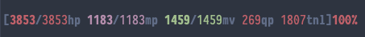

# TinTin++

TinTin++ is a terminal MUD client that is very easy to script for. This page gets you connected to Adventures Unlimited and sets up prompts, chat logging and an idle toggle. The bigger scripts live on their own pages:

- [Crafting loops](crafting-loops.md): mining, smelting, armorsmith, weaponsmith, jewelry and engraving.
- [Training loops](training-loops.md): the quest buffer, the mage buffer and the poison, disease and blind trainers.

Every script on these pages loads in TinTin++ 2.02.61 with no errors or warnings.

## Installing

- Debian and Ubuntu: `sudo apt install tintin++`
- Fedora: `sudo dnf install tintin`
- Arch: `tintin` from the AUR
- macOS: `brew install tintin`
- Windows: WinTin++, the installer from the [TinTin++ download page](https://tintin.mudhalla.net/download.php). It bundles TinTin++ with a terminal.

Distribution packages can lag behind the current release. Run `tt++ -V` to see what you have.

## Organizing your scripts

The most important part of TinTin++ scripting is knowing `#help` and `#help <command>`. Outside of that, keep different scripts in different files. That way you can change a file, save it and reload it into the running session with `#read <filename>` without having to log out.

If you removed aliases or actions from a file, reloading won't remove them from TinTin++'s memory. Clear everything with `#kill all` and reload the files you need. It makes the most sense to have one main file that loads all the others with `#read`, so you only reload that one file.

Comments in a script file start with `#nop`. Don't use `//`: TinTin++ sends that line to the MUD as a command.

## Connecting

Put this at the top of your main file and start TinTin++ with `tt++ <filename>`. It sets your character name and pet name once (several scripts read `$me` and `$pet`), logs you in when TinTin++ starts, splits the screen so your input sits below the MUD output and binds F1 and F2.

> [!CAUTION]
> This script holds your password in plain text. Keep the file private and don't paste it anywhere with the password still in it.

```text
#nop Your character and pet. Other scripts read these.
#var {me} {Yourname}
#var {pet} {yourpet}

#nop Log in to Adventures Unlimited when tt++ starts.
#event {PROGRAM START} {#session au tharel.net 5005;y;$me;yourpassword;y}

#nop Separate input from output.
#split

#nop F1 drinks from your flask and F2 orders your pet to rescue you.
#alias {drinkflask} {take flask pocket;drink flask;put flask pocket}
#macro {\eOP} {take flask pocket;#4 drink flask;put flask pocket}
#macro {\eOQ} {order $pet rescue $me}

#nop Rest on a blanket, this is for a quickling (hence haste and slow).
#alias {sleep} {stand;take blanket pocket;drop blanket;r blanket;slow;sl}
#alias {wake} {rest;haste;stand;take blanket;put blanket pocket;l}
```

`\eOP` and `\eOQ` are the codes xterm sends for F1 and F2. Other terminals send different codes. To bind a key in yours, type `#macro {`, press ctrl-v and then the key (TinTin++ inserts the code the key sends), and finish the line with `} {commands}`.

## Prompts

Each prompt has two parts: an in-game `prompt` command you type once in Adventures Unlimited, and a TinTin++ script that reads that prompt and redraws it in color on the status line.

### Basic prompt



The in-game command:

```text
prompt {D[{R%h{D/{r%Hhp {M%m{D/{m%Mmp {G%v{D/{g%Vmv {r%P{Dqp {r%X{Dtnl]{r%p {R%B%c
```

The TinTin++ side:

```text
#prompt {[%1/%2hp %3/%4mp %5/%6mv %11qp %12tnl] %13} {<109>[<119>%1<109>/<019>%2<109>hp <159>%3<109>/<059>%4<109>mp <129>%5<109>/<029>%6<109>mv <019>%11<109>qp <019>%12<109>tnl]<119>%13<109>}
```

### Monk prompt


The same prompt with chi, quest time and quests left. In-game, `%C` prints your chi as current/max, which the script reads as `%7/%8chi`.

```text
prompt {D[{R%h{D/{r%Hhp {M%m{D/{m%Mmp {G%v{D/{g%Vmv {c%Cchi {Y%q%Q{Dqt {y%l{Dql {r%P{Dqp {r%X{Dtnl]{r%p {R%B%c
```

```text
#prompt {[%1/%2hp %3/%4mp %5/%6mv %7/%8chi %9qt %10ql %11qp %12tnl] %13 %14} {<109>[<119>%1<109>/<019>%2<109>hp <159>%3<109>/<059>%4<109>mp <129>%5<109>/<029>%6<109>mv <169>%7<109>/<069>%8<109>chi <139>%9<109>qt <039>%10<109>ql <019>%11<109>qp <019>%12<109>tnl] <119>%13<109> <119>%14}
```

### Multiline prompt


This one puts your pet's health and how rested you are on their own status lines. It needs `#if` to color the rested state, which `#prompt` can't do, so it uses an `#action` that redraws the prompt and gags the original line.

```text
prompt {D[{R%h{D/{r%Hhp {M%m{D/{m%Mmp {G%v{D/{g%Vmv {r%P{Dqp {r%X{Dtnl] {R[%p] [%B] [%t]%c
```

<details>
<summary>TinTin++ side of the multiline prompt</summary>

```text
#split 0 2
#var {restedState} {none}
#var {petState} {none}
#action {[%1/%2hp %3/%4mp %5/%6mv %7qp %8tnl] [%9] [%10] [%11]} {
  #format {restedState} {%p} {%11};
  #format {petState} {%p} {%9};
  #if {"$petState" == ""} {#var {petState} {<109>No pet}};
  #else {#var {petState} {<109>Pet: <019>$petState}};
  #if {"$restedState" == "You are well rested."} {#var {restedState} {<129>$restedState}};
  #if {"$restedState" == "You feel rested."} {#var {restedState} {<149>$restedState}};
  #if {"$restedState" == "You are a bit tired."} {#var {restedState} {<169>$restedState}};
  #if {"$restedState" == "You feel fatigued."} {#var {restedState} {<159>$restedState}};
  #if {"$restedState" == "You are tired."} {#var {restedState} {<139>$restedState}};
  #if {"$restedState" == "You are asleep on your feet!"} {#var {restedState} {<119>$restedState}};
  #showme {<109>[<119>%1<109>/<019>%2<109>hp <159>%3<109>/<059>%4<109>mp <129>%5<109>/<029>%6<109>mv <019>%7<109>qp <019>%8<109>tnl] $petState <119>%10} {-3};
  #showme {$restedState} {-2};
  #line gag
}
```

</details>

## Chat logging

This writes every channel message and tell to a file called `au.communications` with a timestamp and gags it from the main window. `logline` writes one line of your own to the same file; the idle toggle and the [mage buffer](training-loops.md#mage-buffer) use it.

```text
#nop Log the triggering line to au.communications and gag it.
#alias {logchat} {
  #format {ts} {%t} {%a %H:%M};
  #line log au.communications {<178>$ts \};
  #line log au.communications;
  #line gag
}

#nop Log a line of your own: logline {text}
#alias {logline} {
  #format {ts} {%t} {%a %H:%M};
  #line log au.communications {<178>$ts <088>%1}
}

#action {[\s?\s]} {logchat}
#action {^[{IC|Auction|Music|Question|Answer|OOC|Grats|TOT|Newbie|WAR|Clan}]} {logchat}
#action {OOCly } {logchat}
#action {%1 tells the group '%2'} {logchat}
#action {You tell your group: '%1'} {logchat}
#action {[AFK] mode removed!!!!} {#line gag}
```

Then follow the file in another pane (tmux works well) to keep chat separate:

```sh
tail -f ./au.communications
```

## Idle toggle

When you idle it's best to be asleep so you don't drop held items, and to drink from your flask now and then. Type `idle` to go AFK and `noidle` to come back. Every two minutes it checks the board and who list, drinks, goes back to sleep and sets the AFK flag again, which keeps you from timing out. The AFK flag is the respectful part: others know you aren't actually at the keyboard.

> [!IMPORTANT]
> This needs the `drinkflask` and `sleep` aliases from [Connecting](#connecting) and `logline` from [Chat logging](#chat-logging). The mage buffer only answers requests while `idle` is on.

```text
#var {idling} {false}
#alias {idle} {
  #var {idling} {true};
  #ticker {idlewho} {board;who;stand;drinkflask;sleep;afk} {120};
  logline {--idle start--};
  afk
}
#alias {noidle} {
  #var {idling} {false};
  #unticker {idlewho};
  logline {--idle end--};
  replay
}
```
