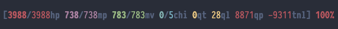
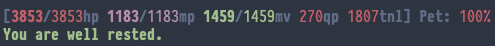

# TinTin++
This powerful MUD client is very easy to script for. This page is a collection of helper scripts to make your life easier.

## Table of Contents
- [Introduction](#introduction)
- [Prompts](#prompts)
- [Chat Logging](#chat-logging)
- [Idle Toggler](#idle-toggler)
- [Quest Buffer](#quest-buffer)
- [Mage Buffer](#mage-buffer)
- [Mining Loop](#mining-loop)
- [Mining Repair Farm](#mining-repair-farm)
- [Mining Repair Loop](#mining-repair-loop)
- [Mining Smelting Loop](#mining-smelting-loop)
- [Armorsmith Fixing Loop](#armorsmith-fixing-loop)
- [Armorsmith Training Loop](#armorsmith-training-loop)
- [Armorsmith Crafting Loop](#armorsmith-crafting-loop)
- [Weaponsmith Fixing Loop](#weaponsmith-fixing-loop)
- [Weaponsmith Training Loop](#weaponsmith-training-loop)
- [Engraving Training Loop](#engraving-training-loop)
- [Jewelery Fixing Loop](#jewelery-fixing-loop)
- [Poison Training Loop](#poison-training-loop)
- [Disease Training Loop](#disease-training-loop)
- [Blind Training Loop](#blind-training-loop)

## Introduction
The most important aspect of tintin++ scripting is knowing `#help` and `#help <command>`, outside of that
it's recommended to keep different scripts in different files that way you can change the file, save it and
then reload it into the active AU session without having to exit/re-enter. 

In order to reload a file you merely `#read $filename`, if you removed different aliases or actions you may
have to remove them from active memory of tintin using the `#kill all` command and reload all the files
you require. In such cases, it makes the most sense to have a single tintin file that loads all other files
with `#read` commands so you only have to reload that one file that calls out to all the others like branches
of a tree.

Outside of that information, here are some basic helpful commands. Set your character and pet name once at the top; the rescue key, the mage buffer and the training loops read `$me` and `$pet`. Comments start with `#nop`: TinTin++ sends a `//` line to the MUD.
```
#nop Your character and pet. Other scripts read these.
#var {me} {Yourname}
#var {pet} {yourpet}

#nop Log in to Adventures Unlimited when tt++ starts.
#event {PROGRAM START} {#session au tharel.net 5005;y;$me;yourpassword;y}

#nop Separate input from output.
#split

#nop F1 drinks from your flask and F2 orders your pet to rescue you.
#alias {drinkflask} {take flask pocket;drink flask;put flask pocket}
#macro {\eOP} {take flask pocket;#4 drink flask;put flask pocket}
#macro {\eOQ} {order $pet rescue $me}

#nop Rest on a blanket, this is for a quickling (hence haste and slow).
#alias {sleep} {stand;take blanket pocket;drop blanket;r blanket;slow;sl}
#alias {wake} {rest;haste;stand;take blanket;put blanket pocket;l}
```
## Prompts

**Basic Prompt**


```
#nop The next line is the in-game command.
prompt {D[{R%h{D/{r%Hhp {M%m{D/{m%Mmp {G%v{D/{g%Vmv {r%P{Dqp {r%X{Dtnl]{r%p {R%B%c

#nop The next line is the TinTin++ side of the same prompt.
#prompt {[%1/%2hp %3/%4mp %5/%6mv %11qp %12tnl] %13} {<109>[<119>%1<109>/<019>%2<109>hp <159>%3<109>/<059>%4<109>mp <129>%5<109>/<029>%6<109>mv <019>%11<109>qp <019>%12<109>tnl]<119>%13<109>}
```

**Monk Prompt**



```
#nop The next line is the in-game command.
prompt {D[{R%h{D/{r%Hhp {M%m{D/{m%Mmp {G%v{D/{g%Vmv {c%Cchi {Y%q%Q{Dqt {y%l{Dql {r%P{Dqp {r%X{Dtnl]{r%p {R%B%c

#nop The next line is the TinTin++ side of the same prompt.
#prompt {[%1/%2hp %3/%4mp %5/%6mv %7/%8chi %9qt %10ql %11qp %12tnl] %13 %14} {<109>[<119>%1<109>/<019>%2<109>hp <159>%3<109>/<059>%4<109>mp <129>%5<109>/<029>%6<109>mv <169>%7<109>/<069>%8<109>chi <139>%9<109>qt <039>%10<109>ql <019>%11<109>qp <019>%12<109>tnl] <119>%13<109> <119>%14}
```

**Multiline Prompt**



This is required to allow switches to go to tintin++.
```
prompt {D[{R%h{D/{r%Hhp {M%m{D/{m%Mmp {G%v{D/{g%Vmv {r%P{Dqp {r%X{Dtnl] {R[%p] [%B] [%t]%c
```
The next block is for tintin++ to configure. It's complex with if statements so we avoid `#prompt`
```
#split 0 2
#var {restedState} {none}
#var {petState} {none}
#action {[%1/%2hp %3/%4mp %5/%6mv %7qp %8tnl] [%9] [%10] [%11]} {
  #format {restedState} {%p} {%11};
  #format {petState} {%p} {%9};
  #if {"$petState" == ""} {#var {petState} {<109>No pet}};
  #else {#var {petState} {<109>Pet: <019>$petState}};
  #if {"$restedState" == "You are well rested."} {#var {restedState} {<129>$restedState}};
  #if {"$restedState" == "You feel rested."} {#var {restedState} {<149>$restedState}};
  #if {"$restedState" == "You are a bit tired."} {#var {restedState} {<169>$restedState}};
  #if {"$restedState" == "You feel fatigued."} {#var {restedState} {<159>$restedState}};
  #if {"$restedState" == "You are tired."} {#var {restedState} {<139>$restedState}};
  #if {"$restedState" == "You are asleep on your feet!"} {#var {restedState} {<119>$restedState}};
  #showme {<109>[<119>%1<109>/<019>%2<109>hp <159>%3<109>/<059>%4<109>mp <129>%5<109>/<029>%6<109>mv <019>%7<109>qp <019>%8<109>tnl] $petState <119>%10} {-3};
  #showme {$restedState} {-2};
  #line gag
}
```
## Chat Logging
You can log your chat to a separate file like this:
```
#nop Log the triggering line to au.communications and gag it.
#alias {logchat} {
  #format {ts} {%t} {%a %H:%M};
  #line log au.communications {<178>$ts \};
  #line log au.communications;
  #line gag
}

#nop Log a line of your own: logline {text}
#alias {logline} {
  #format {ts} {%t} {%a %H:%M};
  #line log au.communications {<178>$ts <088>%1}
}

#action {[\s?\s]} {logchat}
#action {^[{IC|Auction|Music|Question|Answer|OOC|Grats|TOT|Newbie|WAR|Clan}]} {logchat}
#action {OOCly } {logchat}
#action {%1 tells the group '%2'} {logchat}
#action {You tell your group: '%1'} {logchat}
#action {[AFK] mode removed!!!!} {#line gag}
```
Then in another pane in tmux you can just tail your chat to keep it separate:
```
tail -f ./au.communications
```
## Idle Toggler
When idling it's usually best to make sure you're sleeping so you don't drop held items. Drinking from your flask is also a good idea. This toggler requires the `drinkflask` and `sleep` aliases from the introduction and `logline` from chat logging. You type `idle` to go afk and `noidle` to stop being idle. This will keep an `afk` flag on you while preventing your from logging out. It's usually more respectful to have the `afk` flag so others know when you are actually at the keyboard.
```
#var {idling} {false}
#alias {idle} {
  #var {idling} {true};
  #ticker {idlewho} {board;who;stand;drinkflask;sleep;afk} {120};
  logline {--idle start--};
  afk
}
#alias {noidle} {
  #var {idling} {false};
  #unticker {idlewho};
  logline {--idle end--};
  replay
}
```
## Quest Buffer
Here is a script that buffs your character right before a quest:
(you need to either add the 'buff' alias or replace it with commands for buffing delimited by semicolons)
```
#var {readyForQuest} {true}
#action { 1qt } {
  #if {"$readyForQuest" == "false"} {
    buff;
    #var {readyForQuest} {true}
  }
}
#action { 0qt } {
  #if {"$readyForQuest" == "true"} {
    #showme <138>+-----------------------+<088>;
    #showme <138>|    <178>Quest Available<138>    |<088>;
    #showme <138>+-----------------------+<088>;
    #var {readyForQuest} {false}
  }
}
#action {You may now quest again.} {#line gag}
```
## Mage Buffer
There's lots of clever functions in here to make your life easier. It needs `$me` and `$pet` from the introduction, `logline` from chat logging and the idle toggler, and only answers requests while `idle` is on. Requests that claim to come from you (`$me`) are refused and logged: this prevents people from targeting you with any clever pmote/tell/etc line feed hacks. Log their attempts and report them.
```
#var {buffing} {false}
#var {spoofed} {false}

#nop singlebuff {target} {spell}
#alias {singlebuff} {
  #if {"$idling" == "true"} {
    #var {spoofed} {false};
    #regex {%1} {^%i$me$} {#var {spoofed} {true}};
    #if {"$spoofed" == "true"} {
      osay (AUTOMATED) Your abuse has been logged.;
      logline {(%1)(SPOOFED) : single-buff-%2}
    };
    #elseif {"$buffing" == "true"} {
      logline {(%1)(MISSED) : single-buff-%2}
    };
    #else {
      #var {buffing} {true};
      logline {(%1) : single-buff-%2};
      stand;
      c '%2' %1;
      r bench
    }
  }
}

#nop fullbuff {target}
#alias {fullbuff} {
  #if {"$idling" == "true"} {
    #var {spoofed} {false};
    #regex {%1} {^%i$me$} {#var {spoofed} {true}};
    #if {"$spoofed" == "true"} {
      osay (AUTOMATED) Your abuse has been logged.;
      logline {(%1)(SPOOFED) : full-buff}
    };
    #elseif {"$buffing" == "true"} {
      logline {(%1)(MISSED) : full-buff}
    };
    #else {
      #var {buffing} {true};
      logline {(%1) : full-buff};
      stand;
      c regen '%1';
      c haste '%1';
      c giant '%1';
      c sanc '%1';
      c 'stone skin' '%1';
      c 'armor' '%1';
      c 'shield' '%1';
      c phase '%1';
      c 'protection good' '%1';
      c fly '%1';
      r bench
    }
  }
}

#action {Ooc - %1 says 'can %2'} {singlebuff {%2} {can}}
#action {Ooc - %1 says 'can'} {singlebuff {%1} {can}}
#action {Ooc - %1 says 'fly'} {singlebuff {%1} {fly}}
#action {Ooc - %1 says 'regen'} {singlebuff {%1} {regen}}
#action {Ooc - %1 says 'sanc'} {singlebuff {%1} {sanc}}
#action {Ooc - %1 says 'protection good'} {singlebuff {%1} {protection good}}
#action {Ooc - %1 says 'protection evil'} {singlebuff {%1} {protection evil}}
#action {Ooc - %1 says 'protection neutral'} {singlebuff {%1} {protection neutral}}
#action {Ooc - %1 says 'shield'} {singlebuff {%1} {shield}}
#action {Ooc - %1 says 'armor'} {singlebuff {%1} {armor}}
#action {Ooc - %1 says 'giant'} {singlebuff {%1} {giant}}
#action {Ooc - %1 says 'haste'} {singlebuff {%1} {haste}}
#action {Ooc - %1 says 'stone'} {singlebuff {%1} {stone}}
#action {Ooc - %1 says 'phase'} {singlebuff {%1} {phase}}
#action {Ooc - %1 says 'spell %2'} {fullbuff {%2}}
#action {Ooc - %1 %2 says 'spell'} {fullbuff {%2}}
#action {Ooc - %1 says 'spell'} {fullbuff {%1}}
#action {Ooc - %1 says '?spellup?'} {fullbuff {%1}}
#action {You sit on A marble bench and rest.} {#var {buffing} {false}}

#alias {gobuff} {
  gt buff-start;
  buffself;
  buffpet;
  gt buff-end
}
#alias {buffpet} {
  stand;
  #3 c can $pet;
  c regen $pet;
  c 'armor' $pet;
  c 'shield' $pet;
  c 'stone skin' $pet;
  c 'protection good' $pet;
  c sanc $pet;
  c haste $pet;
  c phase $pet;
  c giant $pet;
  order $pet stand
}
#alias {buffself} {
  stand;
  #3 c can;
  c regen;
  c 'armor';
  c 'detect invis';
  c 'detect hidden';
  c 'detect evil';
  c 'detect good';
  c 'protection good';
  c 'shield';
  c 'stone';
  c haste;
  c giant;
  c phase;
  c sanc
}
```
## Mining Loop
There is no substitute for mining manually. Keep in mind that even though much of this is automated, you must continue to man the keyboard while this is ongoing or you are playing against the terms of service and will get in trouble. It merely makes your life easier and allows you to talk with others in the game and watch youtube instead of typing `mine` for the thousandth time. It's best to have a bunch of `clear potions` from heishaer in your `pocket` so as to `refresh` your waking state automatically during the process, the loop does this automatically if those exist. You can adjust the actions to remove the `score` trigger that uses `quaf clear` and replace it with `cast refresh` if you have the spell. Mining is hard work! This will continue to mine putting all xedalium into your pocket and donating everything else to the temple pit. If you have your rested state in your prompt then you can remove the `score` command as it will process automatically while you're mining.
```
#class {mining} {open}
#var {tunnelDirection} {down}
#var {mining} {false}
#alias {td} {
  #var {tunnelDirection} {down};
  #var {mining} {true};
  autoexit;autobrief;automap;
  order $pet recall;
  tunnel $tunnelDirection
}
#alias {tdd} {
  #var {mining} {false};
  autoexit;autobrief;automap;
  recall
}
#alias {drinkclear} {
  #if {"$mining" == "true"} {take clear pocket;quaff clear}
}
#action {Underground Tunnel} {#line gag}
#action {You need to hold a pickaxe in order to dig} {
  hold pickaxe;
  #if {"$mining" == "true"} {
    tunnel $tunnelDirection;
    #showme <108>(tunneling);
    #line gag
  }
}
#action {You feel rested.} {drinkclear}
#action {You are a bit tired.} {drinkclear}
#action {You feel fatigued.} {drinkclear}
#action {You are tired.} {drinkclear}
#action {You are asleep on your feet!} {
  #if {"$mining" == "true"} {
    #var {mining} {false};
    recall;
    sl;
    idle
  }
}
#action {You chip away at the walls making no progress} {
  #if {"$mining" == "true"} {
    score;
    tunnel $tunnelDirection;
    #showme <108>(tunneling-retry)
  }
}
#action {You chip at the walls} {
  #if {"$mining" == "true"} {
    #var {tunnelDirection} {south};
    tunnel $tunnelDirection;
    #showme <108>(tunneling);
    #line gag
  }
}
#action {You hammer at the tunnel walls with a steel pickaxe.} {#line gag}
#action {You chip away at the walls making very little progress} {
  #if {"$mining" == "true"} {
    tunnel $tunnelDirection;
    #showme <108>(tunneling-retry)
  };
  #line gag
}
#action {It won't fit.} {
  #if {"$mining" == "true"} {
    donate chunk temple;
    drop chunk
  }
}
#action {You tunnel %1.} {
  #if {"$mining" == "true"} {
    $tunnelDirection;
    score;
    mine;
    #showme <108>(move %1);
    #line gag
  }
}
#action {You chip off chunks of %1 from the vein.} {
  #if {"%1" == "xedalium"} {
    take chunk;
    put chunk pocket;
    mine;
    #showme <178>+------+ <168> Xedalium Chunk! <178>+------+;
    #line gag
  };
  #else {
    tunnel $tunnelDirection;
    #showme <108>+------+ <048> %1 - Ignoring <108>+------+;
    #line gag
  }
}
#action {You chip off part of the tunnel wall and find a %1 piece of %2.} {
  take %2;
  donate %2 temple;
  #showme <178>+------+ <158> %2 (%1)! <178>+------+;
  mine
}
#action {You fail to mine the ore from the vein} {
  mine;
  #showme <108>(mining-retry);
  #line gag
}
#action {You think there might be ore here but you do not see a vein to mine.} {
  mine;
  #showme <108>(mining-retry);
  #line gag
}
#action {You search for a vein of metal in this tunnel but cannot locate one.} {
  tunnel $tunnelDirection;
  #showme <108>(tunneling);
  #line gag
}
#class {mining} {close}
```
## Mining Repair Farm
Load this after the repair loop below (it replaces the loop's `fmnext`) in order to allow it to automatically drop and destroy dark-trimmed floaters from Bose'nisten and pick them up automatically when farming them. Eventually you might thinking about short-cutting the repair loop if you have the ability to do so, it'll prevent needless usage of "rub" skill afer it's already mastered.
```
#class {miner-repair} {open}
#action {A dark-trimmed %1 falls to the floor} {take %1}
#alias {fmnext} {
  drop $minerRepairItem;
  sac $minerRepairItem;
  fm $minerRepairItem
}
#class {miner-repair} {close}
```

## Mining Repair Loop
Type `fm itemname`. The activation variable is cleared once the item is fully repaired, but the loop shares trigger text with the other repair loops, so load one repair loop at a time (`#class {miner-repair} {kill}` unloads it).
```
#class {miner-repair} {open}
#var {minerRepairItem} {none}
#alias {fm %1} {
  #var {minerRepairItem} {%1};
  reform %1
}
#alias {fmnext} {
  #showme <138>+------+ <188>Finished $minerRepairItem<138> +------+;
  #var {minerRepairItem} {none}
}
#action {You work with a hammer and anvil to improve the condition} {
  #if {"$minerRepairItem" != "none"} {reform $minerRepairItem}
}
#action {You slip with the hammer and miss} {
  #if {"$minerRepairItem" != "none"} {reform $minerRepairItem}
}
#action {This item will need to be reformed} {
  #if {"$minerRepairItem" != "none"} {reform $minerRepairItem}
}
#action {This item needs to be refined} {
  #if {"$minerRepairItem" != "none"} {refine $minerRepairItem}
}
#action {You slip with the steel wool and ding} {
  #if {"$minerRepairItem" != "none"} {refine $minerRepairItem}
}
#action {You refine the dings from} {
  #if {"$minerRepairItem" != "none"} {refine $minerRepairItem}
}
#action {This item needs to be rubbed} {
  #if {"$minerRepairItem" != "none"} {rub $minerRepairItem}
}
#action {You rub a scratch out of} {
  #if {"$minerRepairItem" != "none"} {rub $minerRepairItem}
}
#action {You fail to rub a scratch} {
  #if {"$minerRepairItem" != "none"} {rub $minerRepairItem}
}
#action {You cannot find scratches on} {
  #if {"$minerRepairItem" != "none"} {fmnext}
}
#action {You cannot find any blemishes on} {
  #if {"$minerRepairItem" != "none"} {fmnext}
}
#action {What mineral item do you wish to reform?} {#var {minerRepairItem} {none}}
#class {miner-repair} {close}
```

## Mining Smelting Loop
This loop starts with `m <item to smelt, usually 2.xed> <size, usually 30. see required ore table>`.
It will smelt until the desired chunk size is acquired and then it will throw it in a dimensional pocket.
`note`: This shares triggers with the armorsmithing and weaponsmithing loops; load one at a time.
```
#class {smelting} {open}
#var {smeltingItem} {none}
#var {smeltingSize} {40}
#var {smeltingWeight} {0}
#alias {m %1 %2} {
  #var {smeltingItem} {%1};
  #var {smeltingSize} {%2};
  #showme <138>+------+ <188>Starting smelting $smeltingItem ($smeltingSize lb chunks)<138> +------+;
  smelt $smeltingItem
}
#alias {smeltnext} {
  #var {smeltingWeight} {%1};
  #if {$smeltingWeight >= $smeltingSize} {put %2 pocket};
  smelt $smeltingItem
}
#action {You combine your ore and now have %1 pounds of raw %2.} {smeltnext {%1} {%2}}
#action {You now have %1 pounds of raw %2.} {smeltnext {%1} {%2}}
#action {You fail to smelt} {smelt $smeltingItem}
#class {smelting} {close}
```
## Armorsmith Fixing Loop
The following is an automated repair command for armorsmith. Merely type `f itemname` and it'll fix it provided you have a hammer and wool in your inventory. Load one repair loop at a time.
```
#class {armorsmith-repair} {open}
#var {armorsmithRepairItem} {none}
#alias {f %1} {
  #var {armorsmithRepairItem} {%1};
  rebuild %1
}
#action {This item will need refurbishing} {
  #if {"$armorsmithRepairItem" != "none"} {rebuild $armorsmithRepairItem}
}
#action {You slip with the hammer and miss} {
  #if {"$armorsmithRepairItem" != "none"} {rebuild $armorsmithRepairItem}
}
#action {This item needs to be repaired} {
  #if {"$armorsmithRepairItem" != "none"} {repair $armorsmithRepairItem}
}
#action {You work with a hammer and anvil to improve the condition} {
  #if {"$armorsmithRepairItem" != "none"} {repair $armorsmithRepairItem}
}
#action {This item needs to be readjusted} {
  #if {"$armorsmithRepairItem" != "none"} {readjust $armorsmithRepairItem}
}
#action {This item only needs to be readjusted} {
  #if {"$armorsmithRepairItem" != "none"} {readjust $armorsmithRepairItem}
}
#action {You succeed in removing a few blemishes} {
  #if {"$armorsmithRepairItem" != "none"} {readjust $armorsmithRepairItem}
}
#action {You fail to remove the blemishes} {
  #if {"$armorsmithRepairItem" != "none"} {readjust $armorsmithRepairItem}
}
#action {You cannot find any blemishes on} {#var {armorsmithRepairItem} {none}}
#class {armorsmith-repair} {close}
```
## Armorsmith Training Loop
The following is an automated armorsmith trainer. Merely get a bunch of `silver` items from `Mirage City` and then make sure you have a hammer, file and tongs in you inventory and type `m 2.silver` and it'll smelt everything down and make boots with nothing left over when finished. Because it's action-based you can still communicate over channels while it's running. Once you've mastered everything don't use this, use the automated crafting loop.
```
#class {armorsmith-training} {open}
#var {armorsmithSmeltItem} {none}
#var {armorsmithFormItem} {feet}
#var {armorsmithOre} {unknown}
#var {armorsmithPoundMax} {100}
#var {armorsmithPoundCur} {0}
#alias {m %1} {
  #var {armorsmithSmeltItem} {%1};
  smelt $armorsmithSmeltItem
}
#alias {armorsmithore} {
  #if {%1 < 15} {smelt $armorsmithSmeltItem};
  #else {
    #var {armorsmithOre} {%2};
    hold tongs;
    form $armorsmithOre armor $armorsmithFormItem
  }
}
#action {You fail to smelt} {smelt $armorsmithSmeltItem}
#action {You combine your ore and now have %1 pounds of raw %2.} {armorsmithore {%1} {%2}}
#action {You now have %1 pounds of raw %2.} {armorsmithore {%1} {%2}}
#action {You fail to form} {smelt ruined}
#action {You have broken the form} {smelt broken}
#action {You have cracked the form} {smelt broken}
#action {You filed a large gash into} {smelt $armorsmithSmeltItem}
#action {You use your tongs and the anvil to form} {
  hold hammer;
  #var {armorsmithPoundCur} {0};
  pound $armorsmithFormItem
}
#action {* CLANG! *} {
  #math {armorsmithPoundCur} {$armorsmithPoundCur + 1};
  #if {$armorsmithPoundCur < $armorsmithPoundMax} {
    hold hammer;
    pound $armorsmithFormItem
  };
  #else {
    hold tongs;
    quench $armorsmithFormItem
  }
}
#action {You quench the form of the} {
  hold file;
  finish $armorsmithFormItem
}
#action {You file down} {smelt $armorsmithOre}
#class {armorsmith-training} {close}
```
## Armorsmith Crafting Loop
The following is a completely automated crafting loop. It smelts failures and automatically restarts until it made an item or you're out of resources. Make sure you you have a hammer, file and tongs in your inventory as well as items to smelt. `m (item name to smelt) (target equip slot) (target level)`:
```
#class {armorsmith-crafting} {open}
#var {armorsmithSmeltItem} {none}
#var {armorsmithFormItem} {feet}
#var {armorsmithOre} {unknown}
#var {armorsmithQuantity} {40}
#var {armorsmithPoundMax} {15}
#var {armorsmithPoundCur} {0}
#var {armorsmithForming} {false}
#var {armorsmithLevel} {105}
#alias {m %1 %2 %3} {
  #var {armorsmithSmeltItem} {%1};
  #var {armorsmithFormItem} {%2};
  #var {armorsmithLevel} {%3};
  #if {"%2" == "head"} {#var {armorsmithQuantity} {40}};
  #if {"%2" == "neck"} {#var {armorsmithQuantity} {30}};
  #if {"%2" == "arms"} {#var {armorsmithQuantity} {25}};
  #if {"%2" == "wrist"} {#var {armorsmithQuantity} {30}};
  #if {"%2" == "hands"} {#var {armorsmithQuantity} {25}};
  #if {"%2" == "torso"} {#var {armorsmithQuantity} {45}};
  #if {"%2" == "waist"} {#var {armorsmithQuantity} {40}};
  #if {"%2" == "legs"} {#var {armorsmithQuantity} {30}};
  #if {"%2" == "feet"} {#var {armorsmithQuantity} {15}};
  #if {"%2" == "hold"} {#var {armorsmithQuantity} {30}};
  #if {"%2" == "shield"} {#var {armorsmithQuantity} {30}};
  #showme <138>+------+ <188>Starting level $armorsmithLevel $armorsmithSmeltItem ($armorsmithQuantity ore)<138> +------+;
  smelt $armorsmithSmeltItem
}
#alias {armorsmithore} {
  #if {%1 < $armorsmithQuantity && "$armorsmithForming" != "true"} {smelt $armorsmithSmeltItem};
  #if {%1 >= $armorsmithQuantity} {
    #var {armorsmithOre} {%2};
    #var {armorsmithForming} {true};
    hold tongs;
    form '$armorsmithOre' armor $armorsmithFormItem
  }
}
#action {You combine your ore and now have %1 pounds of raw %2.} {armorsmithore {%1} {%2}}
#action {You now have %1 pounds of raw %2.} {armorsmithore {%1} {%2}}
#action {You fail to form} {
  #var {armorsmithForming} {false};
  smelt ruined
}
#action {You have broken the form} {
  #var {armorsmithForming} {false};
  smelt broken
}
#action {You have cracked the form} {
  #var {armorsmithForming} {false};
  smelt broken
}
#action {You filed a large gash into} {
  #var {armorsmithForming} {false};
  smelt $armorsmithSmeltItem
}
#action {You use your tongs and the anvil to form} {
  #var {armorsmithPoundCur} {0};
  pound $armorsmithFormItem
}
#action {* CLANG! *} {
  #math {armorsmithPoundCur} {$armorsmithPoundCur + 1};
  #if {$armorsmithPoundCur < $armorsmithPoundMax} {
    #showme <178>+------+ <188> Pounding <168>$armorsmithPoundCur<178>/<068>$armorsmithPoundMax <178>+------+;
    pound $armorsmithFormItem
  };
  #else {
    #showme <178>+------+ <188> Successful Pound! <178>+------+;
    hold tongs;
    quench $armorsmithFormItem
  }
}
#action {You need a hammer to shape} {
  hold hammer;
  pound $armorsmithFormItem
}
#action {You quench the form of the} {
  hold file;
  finish $armorsmithFormItem $armorsmithLevel
}
#action {You file down} {
  #var {armorsmithForming} {false};
  condition $armorsmithOre;
  #showme <138>+------+ <188>Finished $armorsmithFormItem<138> +------+
}
#class {armorsmith-crafting} {close}
```
## Weaponsmith Fixing Loop
Type `fw itemname`, or `fwm` to fix one of each Mirage weapon. This shares triggers with the mining and armorsmith loops; load one at a time.
```
#class {weaponsmith-repair} {open}
#var {weaponRepairItem} {none}
#var {weaponRepairCurrent} {none}
#alias {fw %1} {
  #var {weaponRepairItem} {%1};
  reconstruct %1
}
#action {You work with a hammer and anvil to improve the condition} {
  #if {"$weaponRepairItem" != "none"} {reconstruct $weaponRepairItem}
}
#action {You slip with the hammer and miss} {
  #if {"$weaponRepairItem" != "none"} {reconstruct $weaponRepairItem}
}
#action {This item will need reconstructing} {
  #if {"$weaponRepairItem" != "none"} {reconstruct $weaponRepairItem}
}
#action {This item needs to be reconditioned} {
  #if {"$weaponRepairItem" != "none"} {recondition $weaponRepairItem}
}
#action {This item needs regular maintenance} {
  #if {"$weaponRepairItem" != "none"} {maintain $weaponRepairItem}
}
#action {This item only needs regular maintenance} {
  #if {"$weaponRepairItem" != "none"} {maintain $weaponRepairItem}
}
#action {You fail to remove the blemishes from} {
  #if {"$weaponRepairItem" != "none"} {maintain $weaponRepairItem}
}
#action {You remove a few blemishes from} {
  #if {"$weaponRepairItem" != "none"} {maintain $weaponRepairItem}
}
#action {You cannot find any blemishes on} {
  #var {weaponRepairItem} {none};
  #if {"$weaponRepairCurrent" != "none"} {fwmnext}
}
#action {What weapon did you wish to maintain?} {
  #var {weaponRepairItem} {none};
  #if {"$weaponRepairCurrent" != "none"} {fwmnext}
}

#nop Mirage City weapon farming.
#alias {fwm} {
  #var {weaponRepairCurrent} {axe};
  fw axe
}
#alias {fwmnext} {
  #if {"$weaponRepairCurrent" == "axe"} {
    #var {weaponRepairCurrent} {spear};
    fw spear
  };
  #elseif {"$weaponRepairCurrent" == "spear"} {
    #var {weaponRepairCurrent} {mace};
    fw mace
  };
  #elseif {"$weaponRepairCurrent" == "mace"} {
    #var {weaponRepairCurrent} {staff};
    fw staff
  };
  #elseif {"$weaponRepairCurrent" == "staff"} {
    #var {weaponRepairCurrent} {flail};
    fw flail
  };
  #else {
    #var {weaponRepairCurrent} {none};
    #showme <138>+------+ <188>Done Fixing Mirage<138> +------+
  }
}
#action {       * a damaged flail} {take flail corpse}
#action {       * a small bronze spear} {take spear corpse}
#action {       * a steel mace} {take mace corpse}
#action {       * a bronze staff} {take staff corpse}
#action {       * a steel axe} {take axe corpse}
#action {       * a large broadsword} {take broad corpse}
#class {weaponsmith-repair} {close}
```

## Weaponsmith Training Loop
The best way to start this loop is taking all your silver items from `mirage` from your pocket and then doing `m 2.silver`. Daggers are the best way to train weaponsmith even though they're 30lb of metal to craft. This will take a lot longer then armorsmith.
```
#class {weaponsmith-training} {open}
#var {weaponsmithSmeltItem} {none}
#var {weaponsmithFormItem} {dagger}
#var {weaponsmithOre} {unknown}
#var {weaponsmithHammerMax} {100}
#var {weaponsmithHammerCur} {0}
#alias {m %1} {
  #var {weaponsmithSmeltItem} {%1};
  smelt $weaponsmithSmeltItem
}
#alias {weaponsmithore} {
  #if {%1 < 30} {smelt $weaponsmithSmeltItem};
  #else {
    #var {weaponsmithOre} {%2};
    hold tongs;
    form $weaponsmithOre weapon $weaponsmithFormItem
  }
}
#action {You fail to smelt} {smelt $weaponsmithSmeltItem}
#action {You combine your ore and now have %1 pounds of raw %2.} {weaponsmithore {%1} {%2}}
#action {You now have %1 pounds of raw %2.} {weaponsmithore {%1} {%2}}
#action {You fail to form} {smelt ruined}
#action {You have broken the form} {smelt broken}
#action {You have cracked the form} {smelt broken}
#action {You filed a large gash into} {smelt $weaponsmithSmeltItem}
#action {You use your tongs and the anvil to form} {
  hold hammer;
  #var {weaponsmithHammerCur} {0};
  hammer $weaponsmithFormItem
}
#action {* CLANG! *} {
  #math {weaponsmithHammerCur} {$weaponsmithHammerCur + 1};
  #if {$weaponsmithHammerCur < $weaponsmithHammerMax} {
    hold hammer;
    hammer $weaponsmithFormItem
  };
  #else {
    hold tongs;
    quench $weaponsmithFormItem
  }
}
#action {You quench the form of the} {
  hold file;
  file $weaponsmithFormItem
}
#action {You file down} {smelt $weaponsmithOre}
#class {weaponsmith-training} {close}
```
## Jewelery Fixing Loop
Type `fj itemname`. This shares triggers with the other repair loops ("You slip with the hammer and miss", "You cannot find scratches"), so load one repair loop at a time.
```
#class {jeweler-repair} {open}
#var {jewelerRepairItem} {none}
#alias {fj %1} {
  #var {jewelerRepairItem} {%1};
  resurface %1
}
#action {You work with a hammer and workbench to improve} {
  #if {"$jewelerRepairItem" != "none"} {resurface $jewelerRepairItem}
}
#action {You slip with the hammer and miss} {
  #if {"$jewelerRepairItem" != "none"} {resurface $jewelerRepairItem}
}
#action {This item will need to be resurfaced} {
  #if {"$jewelerRepairItem" != "none"} {resurface $jewelerRepairItem}
}
#action {This item needs to be buffed} {
  #if {"$jewelerRepairItem" != "none"} {buff $jewelerRepairItem}
}
#action {You slip with the cloth and ding} {
  #if {"$jewelerRepairItem" != "none"} {buff $jewelerRepairItem}
}
#action {You buff the dings out of} {
  #if {"$jewelerRepairItem" != "none"} {buff $jewelerRepairItem}
}
#action {This item needs polishing} {
  #if {"$jewelerRepairItem" != "none"} {polish $jewelerRepairItem}
}
#action {This item only needs polishing} {
  #if {"$jewelerRepairItem" != "none"} {polish $jewelerRepairItem}
}
#action {You fail to polish a scratch out of} {
  #if {"$jewelerRepairItem" != "none"} {polish $jewelerRepairItem}
}
#action {You buff a scratch out of} {
  #if {"$jewelerRepairItem" != "none"} {polish $jewelerRepairItem}
}
#action {You cannot find scratches on} {#var {jewelerRepairItem} {none}}
#action {You cannot find any blemishes on} {#var {jewelerRepairItem} {none}}
#action {You cannot find any damage to} {#var {jewelerRepairItem} {none}}
#class {jeweler-repair} {close}
```
## Engraving Training Loop
```
#class {engraving} {open}
#var {engraved} {no}
#action {You slip engraving} {
  #if {"$engraved" == "no"} {engrave ring engraving test};
  #else {engrave ring erase engraving}
}
#action {You engrave} {
  #var {engraved} {yes};
  engrave ring erase engraving
}
#action {You remove the inscription} {
  #var {engraved} {no};
  engrave ring engraving test
}
#action {is of too poor a quality to engrave} {
  #var {engraved} {no};
  drop ring;
  engrave ring engraving test
}
#action {already has an engraving} {
  #var {engraved} {yes};
  engrave ring erase engraving
}
#class {engraving} {close}
```
## Poison Training Loop
For classes that have 'cure poison' and 'poison', this is the fastest way to master both skills. It casts on yourself (`$me`).
```
#class {train-poison} {open}
#var {farmState} {none}
#action {You feel less sick} {
  #var {farmState} {none};
  c 'poison' $me
}
#action {You feel momentarily ill} {c 'poison' $me}
#action {The poison in you is resistant} {c 'cure poison' $me}
#action {You feel sick} {
  #var {farmState} {yes};
  c 'cure poison' $me
}
#action {You lost your concentration} {
  #if {"$farmState" == "none"} {c 'poison' $me};
  #else {c 'cure poison' $me}
}
#class {train-poison} {close}
```
## Disease Training Loop
For classes that have 'cure disease' and 'plague', this is the fastest way to master both skills. It casts on yourself (`$me`).
```
#class {train-disease} {open}
#var {farmState} {none}
#action {Your sores vanish} {
  #var {farmState} {none};
  c 'plague' $me
}
#action {You feel momentarily ill} {c 'plague' $me}
#action {The curse of the plague on you is resistant} {c 'cure disease' $me}
#action {You scream in agony as plague} {
  #var {farmState} {yes};
  c 'cure disease' $me
}
#action {You lost your concentration} {
  #if {"$farmState" == "none"} {c 'plague' $me};
  #else {c 'cure disease' $me}
}
#class {train-disease} {close}
```
## Blind Training Loop
For classes that have 'cure blind' and 'blind', this is the fastest way to master both skills. It casts on yourself (`$me`).
```
#class {train-blind} {open}
#var {farmState} {none}
#action {You can see again.} {
  #var {farmState} {none};
  c 'blind' $me
}
#action {The room seems darker.. then gets} {c 'blind' $me}
#action {The curse of blindness on you is resistant} {c 'cure blind' $me}
#action {You are blinded!} {
  #var {farmState} {yes};
  c 'cure blind' $me
}
#action {You lost your concentration} {
  #if {"$farmState" == "none"} {c 'blind' $me};
  #else {c 'cure blind' $me}
}
#class {train-blind} {close}
```
